<div align="center">

# ShopSphere

**A full-stack e-commerce web app with a React frontend and a REST API.**
Search and filter products, check out, track orders, and manage the store from an admin dashboard.

[](https://github.com/codewithsatyamsharma/shopsphere/actions/workflows/ci.yml)


[](LICENSE)

<!-- After you deploy, add your link here:  [**Live demo**](https://your-site.vercel.app) -->

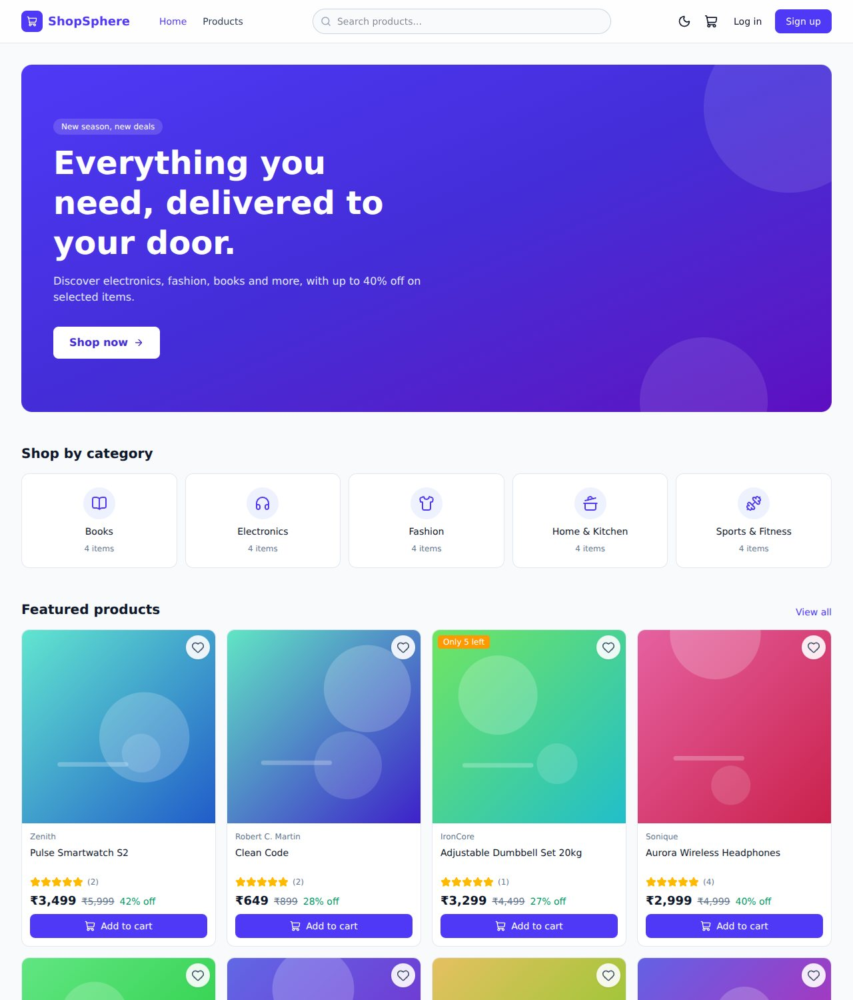

</div>

---

## Table of contents

- [Overview](#overview)
- [Features](#features)
- [Screenshots](#screenshots)
- [Tech stack](#tech-stack)
- [Architecture](#architecture)
- [Getting started](#getting-started)
- [Available scripts](#available-scripts)
- [Project structure](#project-structure)
- [API overview](#api-overview)
- [Engineering highlights](#engineering-highlights)
- [Testing](#testing)
- [Deployment](#deployment)
- [Roadmap](#roadmap)
- [Troubleshooting](#troubleshooting)
- [Contributing](#contributing)
- [License](#license)
- [Author](#author)

## Overview

ShopSphere is a complete online store: shoppers browse a catalogue, save favourites, build a cart, check out and follow their orders,
while an administrator manages products and orders from a dashboard.

The project was built to practise production-style frontend engineering: state management, routing, forms and validation,
data fetching, performance, accessibility and testing, backed by a small but realistic API that enforces the business rules
(prices, stock, permissions) on the server.

## Features

**Shopping**
- Product catalogue with **debounced search**, category, price and rating filters, sorting and pagination
- All filters live in the **URL**, so every view is shareable and survives a refresh
- Product page with image gallery, discount pricing, stock status, related products and customer reviews
- **Wishlist** with instant (optimistic) updates that roll back if the request fails
- Shopping cart saved in the browser, with quantity limits based on stock
- **Three-step checkout** (shipping, payment, review) with validation on every step
- Order history with **infinite scroll**, status filters, a progress timeline and cancellation

**Accounts and security**
- Register, log in, persistent sessions and a change-password form
- Protected pages and a **role-based admin area**
- Authentication through an **httpOnly cookie**, so scripts cannot read the token

**Admin dashboard**
- Revenue and order charts for the last 14 days, top products and low-stock alerts
- Create, edit, archive and restore products
- Manage orders through a status workflow that only allows valid transitions

**Quality**
- Dark mode, responsive layout, loading skeletons, empty and error states, toast notifications
- Lazy-loaded pages, an error boundary, image fallbacks and keyboard-friendly, labelled forms

## Screenshots

<table>
  <tr>
    <td width="50%">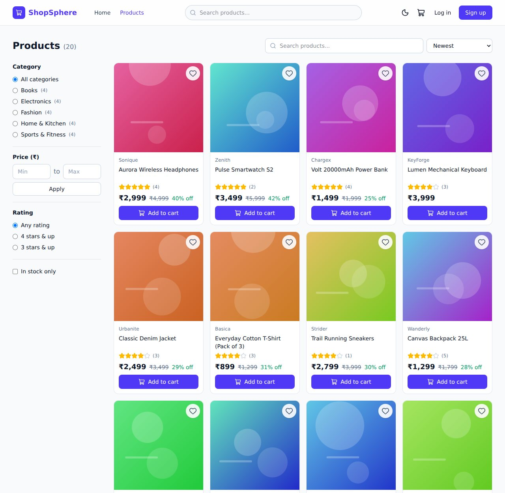<br><sub><b>Products</b>: search, filters, sorting, pagination</sub></td>
    <td width="50%">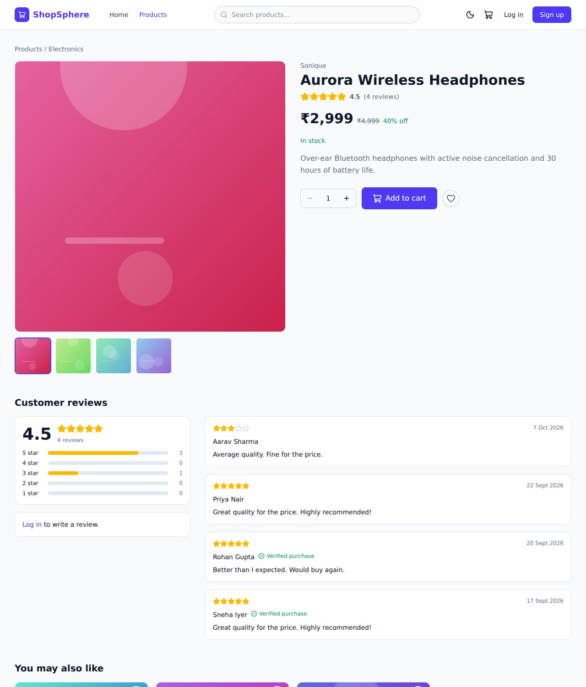<br><sub><b>Product details</b>: gallery, reviews, related items</sub></td>
  </tr>
  <tr>
    <td>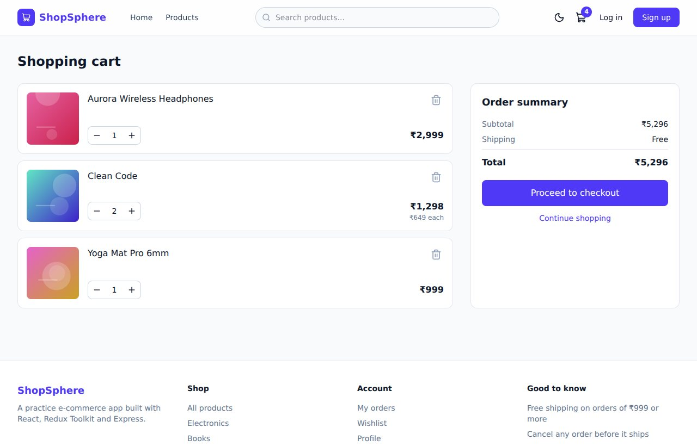<br><sub><b>Cart</b>: quantities, free-shipping hint</sub></td>
    <td>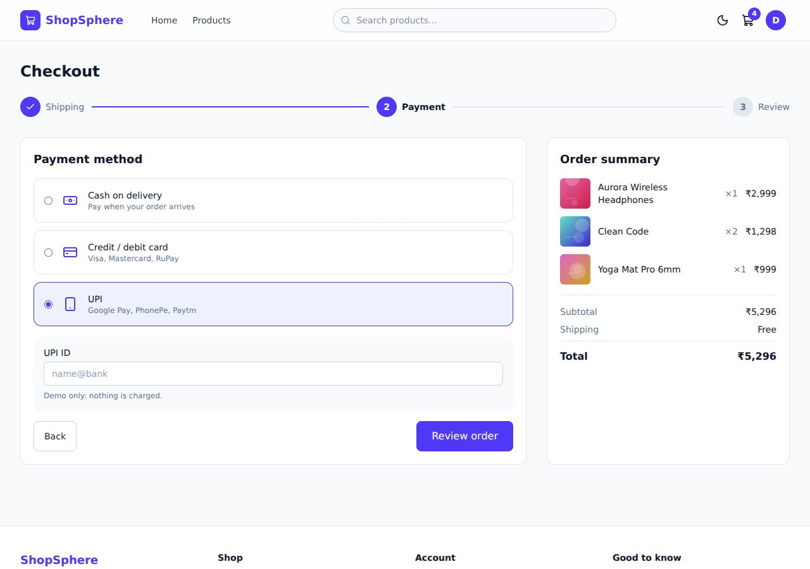<br><sub><b>Checkout</b>: three guided steps</sub></td>
  </tr>
  <tr>
    <td>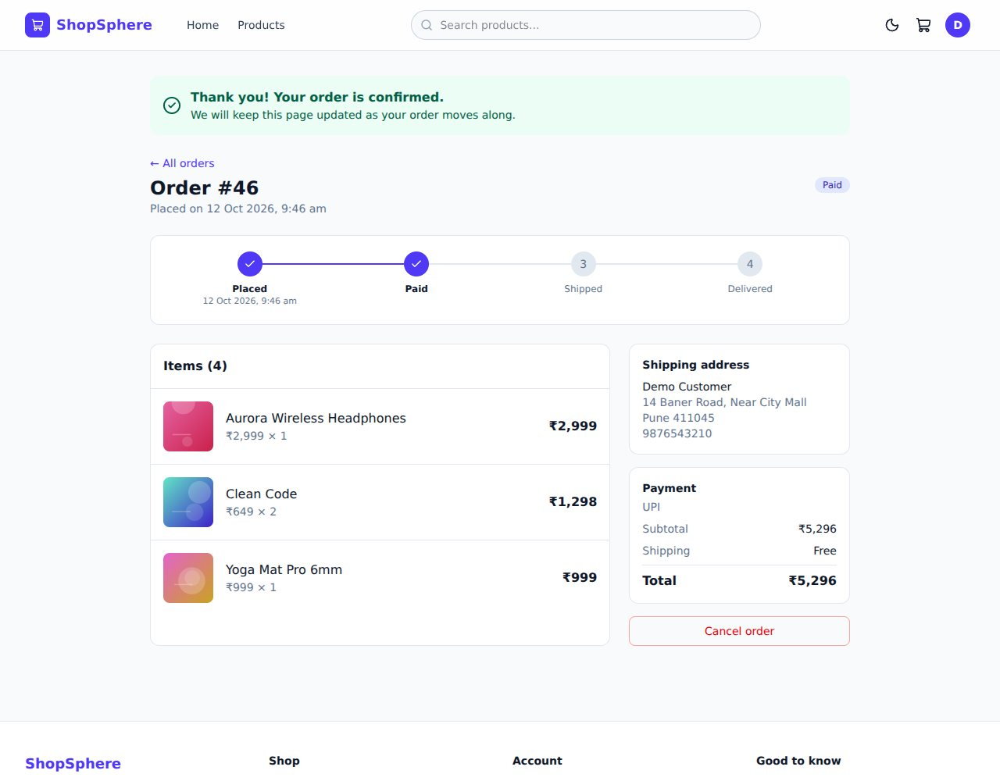<br><sub><b>Order details</b>: timeline and cancellation</sub></td>
    <td>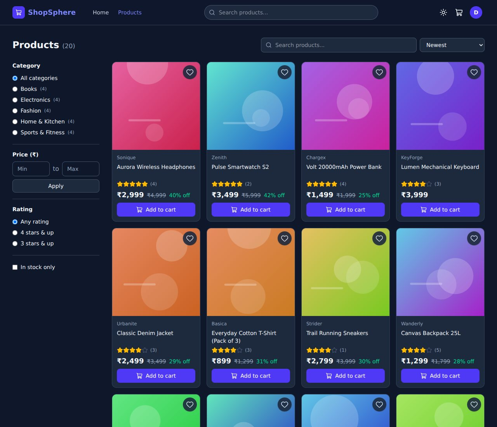<br><sub><b>Dark mode</b></sub></td>
  </tr>
  <tr>
    <td>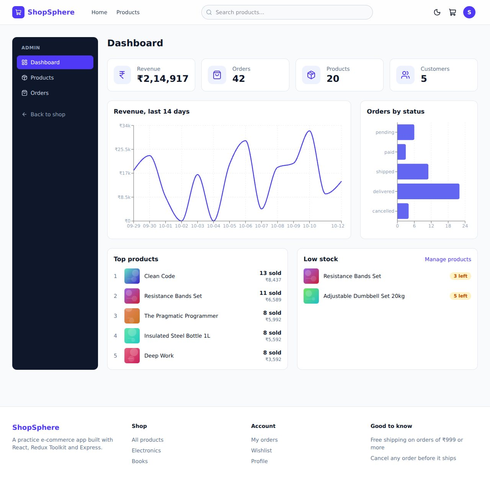<br><sub><b>Admin dashboard</b>: stats and charts</sub></td>
    <td>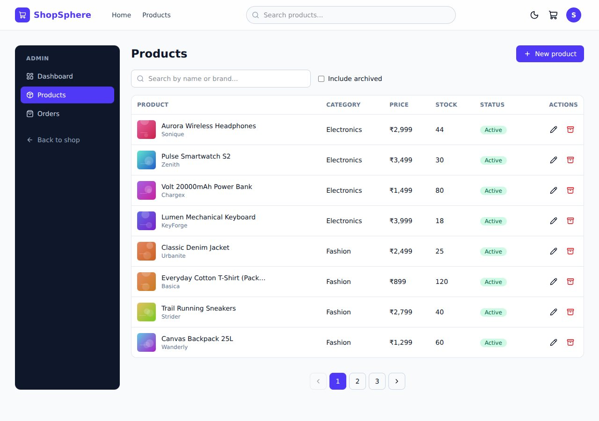<br><sub><b>Admin products</b>: create, edit, archive</sub></td>
  </tr>
</table>

<div align="center">
  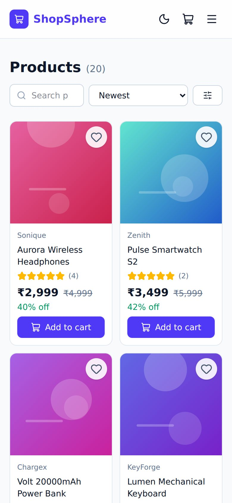<br>
  <sub><b>Mobile</b>: fully responsive</sub>
</div>

## Tech stack

| Area | Technology |
|---|---|
| UI | React 19, React Router 7 |
| State | Redux Toolkit (auth, cart, wishlist), Context API (theme), local component state and custom hooks |
| Forms | react-hook-form with zod schemas |
| Data fetching | axios, a shared `useApi` hook with request cancellation |
| Styling | Tailwind CSS 4 |
| Charts and icons | Recharts, lucide-react |
| Tooling | Vite 8, Vitest, React Testing Library |
| API | Node.js 22, Express 4 |
| Database | SQLite through better-sqlite3 (nothing to install) |
| Auth and validation | JWT in an httpOnly cookie, bcrypt, zod, Helmet, rate limiting |
| CI | GitHub Actions |

## Architecture

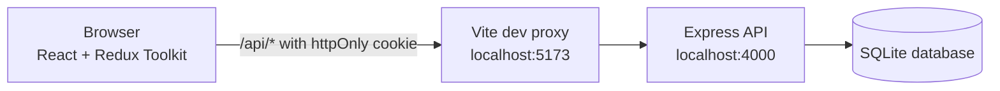

In development the browser only talks to `localhost:5173`. Vite forwards every `/api` request to the API, so the app has **no CORS
issues** and the login cookie is a normal first-party cookie. The same pattern works in production with a rewrite rule (see [Deployment](#deployment)).

**Data model**

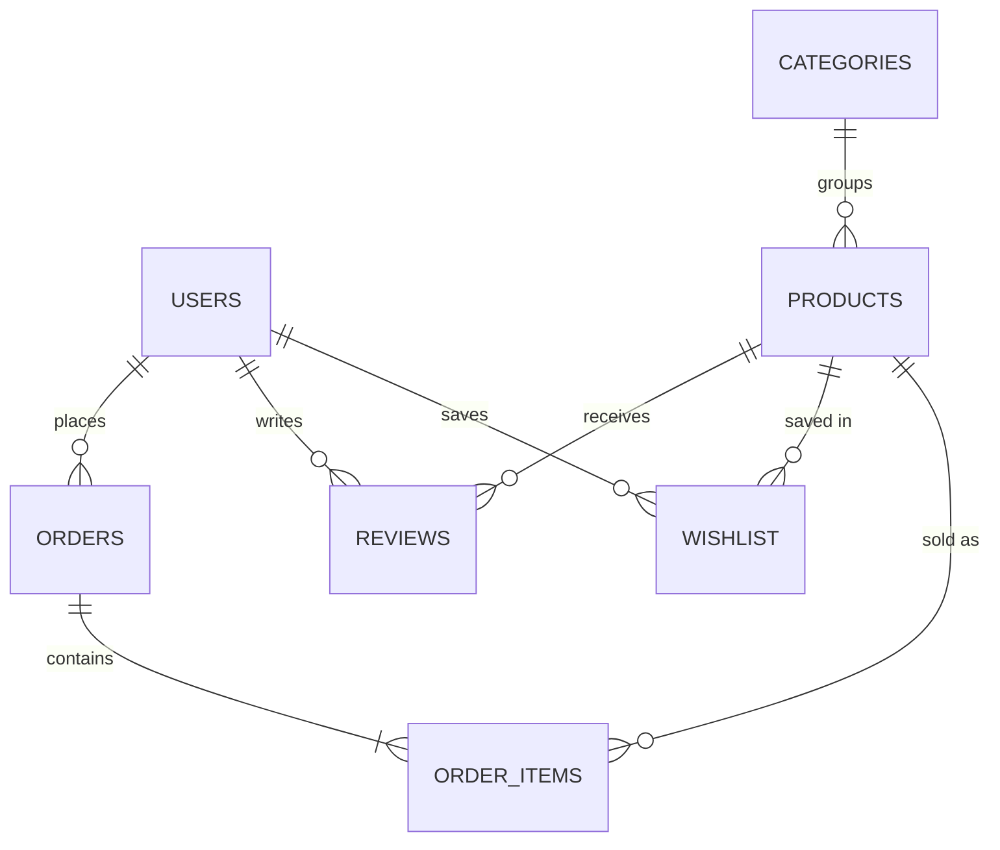

**Placing an order.** The client sends only product ids and quantities. The server looks up the real prices and reserves stock inside one transaction:

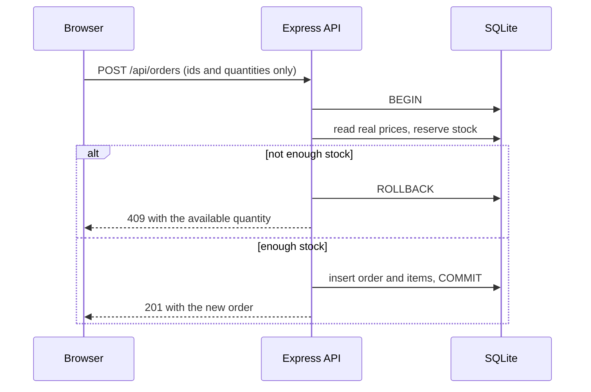

## Getting started

### Prerequisites

- **Node.js 22 or newer** (check with `node -v`)
- npm (included with Node.js)

No database setup is needed: SQLite creates its file on first run.

### Installation

```bash
git clone https://github.com/codewithsatyamsharma/shopsphere.git
cd shopsphere
npm install      # installs the root, backend and frontend in one step
npm run dev      # starts the API and the website together
```

Open **http://localhost:5173**. On first start the database is created and filled with 20 products, 5 categories,
5 customers, reviews and 45 orders.

### Demo accounts

| Role | Email | Password |
|---|---|---|
| Customer | `demo@shopsphere.local` | `Demo@1234` |
| Admin | `admin@shopsphere.local` | `Admin@123` |

On the login page, the **Customer** and **Admin** buttons fill these in for you.

### Configuration (optional)

Everything works without configuration. To change a setting, copy `backend/.env.example` to `backend/.env`.

| Variable | Default | Purpose |
|---|---|---|
| `PORT` | `4000` | API port |
| `JWT_SECRET` | development value | Secret used to sign login tokens. **Required in production.** |
| `CLIENT_URL` | `http://localhost:5173` | Allowed browser origin (CORS) |
| `DB_PATH` | `./data/shopsphere.db` | Location of the SQLite file |
| `NODE_ENV` | `development` | Set to `production` when deploying |

If the API runs somewhere else, start the frontend with `API_TARGET=http://host:port npm run dev:web`.

## Available scripts

Run these from the repository root.

| Command | Description |
|---|---|
| `npm run dev` | Start the API (port 4000) and the frontend (port 5173) together |
| `npm run dev:api` | Start only the API |
| `npm run dev:web` | Start only the frontend |
| `npm run seed` | Reset the database and reload the demo data |
| `npm test` | Run the backend and frontend test suites |
| `npm run build` | Create a production build of the frontend in `frontend/dist` |

## Project structure

```
shopsphere/
├── .github/workflows/ci.yml   tests and build on every push and pull request
├── docs/screenshots/          images used in this README
├── package.json               root scripts that run both halves
├── backend/
│   ├── src/
│   │   ├── routes/            auth, products, reviews, wishlist, orders, admin
│   │   ├── middleware/        authentication, validation, error handling
│   │   ├── services/          order creation and cancellation (transactions)
│   │   ├── db.js              schema and connection
│   │   └── seed.js            demo data
│   ├── tests/                 API tests
│   └── README.md              full endpoint reference
└── frontend/
    └── src/
        ├── app/               store, router, root component
        ├── components/        shared UI kit (Button, Input, Modal, ...) and layouts
        ├── features/          auth, products, cart, checkout, orders, wishlist, profile, admin
        ├── hooks/             useApi, useDebounce, useInfiniteScroll, useLocalStorage, ...
        ├── context/           theme (dark mode)
        └── lib/               axios instance, formatting, image fallback
```

The frontend is organised **by feature**: each folder under `features/` holds its own pages, components, hooks and state.

## API overview

All routes are under `/api`. Responses share one shape, `{ success, message?, data?, errors? }`, and validation failures
return `errors: [{ field, message }]` so a form can show each message under the right input.
The complete reference, with request and response details, is in [`backend/README.md`](backend/README.md).

| Area | Endpoints | Access |
|---|---|---|
| Auth | `POST /auth/register`, `/auth/login`, `/auth/logout`, `GET /auth/me`, `PATCH /auth/me`, `/auth/password` | Public or signed in |
| Catalogue | `GET /products`, `/products/featured`, `/products/:id`, `/products/:id/related`, `GET /categories` | Public |
| Reviews | `GET` and `POST /products/:id/reviews`, `DELETE /reviews/:id` | Public read, signed-in write |
| Wishlist | `GET /wishlist`, `PUT` and `DELETE /wishlist/:productId` | Signed in |
| Orders | `POST /orders`, `GET /orders/my`, `GET /orders/:id`, `PATCH /orders/:id/cancel` | Signed in |
| Admin | `GET /admin/stats`, `GET /admin/orders`, `PATCH /admin/orders/:id/status`, `POST`, `PATCH` and `DELETE /products` | Admin only |

## Engineering highlights

**Security and data integrity**
- The cart sends only product ids and quantities. **Prices, totals and shipping are calculated on the server**, so a tampered browser cannot change what you pay. See `backend/src/services/orders.js`.
- Order creation runs in a **database transaction** with an atomic stock check (`stock >= quantity`). If any line fails, everything rolls back, so two shoppers can never buy the last item.
- Passwords are hashed with bcrypt. The session is a JWT in an **httpOnly, SameSite cookie**. Login errors are identical for "unknown email" and "wrong password".
- Every request body, query and parameter is validated with zod. All SQL is parameterised, and sorting uses a fixed allow-list instead of user text.
- Helmet headers, login rate limiting, and ownership checks (another user's order returns 404, not 403).

**Frontend patterns**
- **URL as the source of truth for filters** (`useProductFilters`), so links are shareable and Back works.
- A shared `useApi` hook **cancels in-flight requests** with `AbortController`, which prevents stale search results from overwriting newer ones.
- **Debounced search** with a custom `useDebounce` hook sends one request per pause, not one per keystroke.
- Redux Toolkit for shared state, with **memoised selectors**, async thunks that reject with plain data, and listener middleware that persists the cart.
- **Optimistic wishlist** updates in the `pending` reducer, with rollback on `rejected`.
- `useReducer` for the checkout wizard, `React.memo` on product cards, `IntersectionObserver` for infinite scroll, and a portal-based modal.
- Forms use react-hook-form and zod, and **server validation errors are mapped back onto the matching fields**.
- Code splitting per route with `React.lazy`, an error boundary, and graceful image fallbacks.

## Testing

```bash
npm test
```

| Suite | What it covers |
|---|---|
| Backend, 29 tests | Authentication and cookies, validation errors, search, filters and pagination, SQL-injection input, wishlist, reviews, order pricing, stock rollback, cancellation, admin permissions and status workflow |
| Frontend, 30 tests | Cart reducer and selectors, checkout reducer, `useDebounce` with fake timers, pagination component, `ProductCard` with a real store and router, image fallback |

The same commands, plus a production build, run automatically on every push through [GitHub Actions](.github/workflows/ci.yml).

## Deployment

**Frontend** (Vercel or Netlify)
1. Build command `npm run build`, output directory `frontend/dist`, root directory `frontend`.
2. Edit `frontend/vercel.json` and replace `YOUR-API-HOST` with your API's address. The first rule forwards `/api` to the API, so the login cookie stays first-party. The second rule makes deep links such as `/products/5` work after a refresh.

**Backend** (Render, Railway or Fly.io)
1. Start command `npm start`, root directory `backend`.
2. Set `NODE_ENV=production`, `JWT_SECRET` (a long random string), `CLIENT_URL` (your frontend's exact URL) and `DB_PATH`.
3. SQLite stores data in a file. Attach a persistent disk, or accept that demo data is recreated on each deploy.

## Roadmap

- [ ] Migrate the frontend to TypeScript
- [ ] Replace the data-fetching hook with TanStack Query for caching and background refresh
- [ ] End-to-end tests with Playwright
- [ ] Real payments (Stripe) and order confirmation emails
- [ ] Product image upload
- [ ] PostgreSQL for production deployments

## Troubleshooting

| Problem | Fix |
|---|---|
| `npm install` reports an unsupported Node version | Install Node 22 or newer (`nvm install 22 && nvm use 22`) |
| The page loads but there are no products | The API is not running. Open http://localhost:4000/api/health to check. |
| `EADDRINUSE` on port 4000 or 5173 | Another program uses the port. Stop it, or run the API with `PORT=4001` and the frontend with `API_TARGET=http://127.0.0.1:4001`. |
| Product photos are grey bags | Photos come from picsum.photos. When offline, a placeholder is shown. |
| You want a clean database | `npm run seed` |
| You edited `vite.config.js` and nothing changed | Restart `npm run dev` |

## Contributing

Contributions are welcome. Please open an issue first to discuss larger changes.

1. Fork the repository and create a branch: `git checkout -b feat/my-change`
2. Make your changes and add tests where it makes sense
3. Run `npm test` and `npm run build`
4. Commit using [Conventional Commits](https://www.conventionalcommits.org/) (`feat:`, `fix:`, `docs:`, `test:`, `chore:`)
5. Open a pull request

## License

Released under the [MIT License](LICENSE).

## Author

**Satyam Sharma**

[GitHub](https://github.com/codewithsatyamsharma)

## Acknowledgements

Product photos are placeholders from [Picsum Photos](https://picsum.photos). Icons by [Lucide](https://lucide.dev).
All products, people and orders in the demo data are fictional, and payments are simulated.
